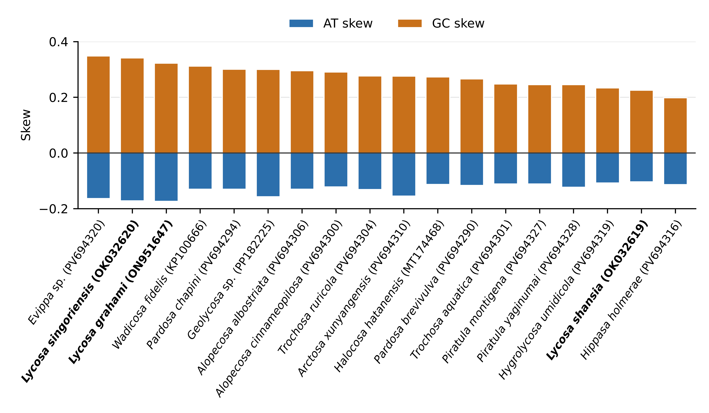
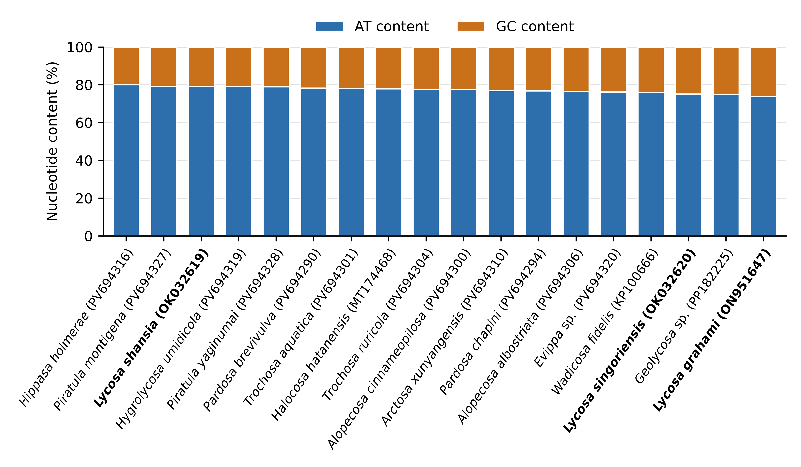

# mito_composition

[](https://doi.org/10.5281/zenodo.24384305)

Nucleotide composition (A, T, G, C, AT and GC content) and strand skew (AT and GC skew) for a folder of mitogenome FASTA files, with two publication-ready figures. Written to run from the IDLE 3.13 shell; it can also be run from the command line.

**Current version:** 1.1.2 (2026-11-19) &nbsp;·&nbsp; **Author:** L. Brian Patrick, Department of Biological Sciences, Dakota Wesleyan University ([ORCID 0000-0003-1969-9600](https://orcid.org/0000-0003-1969-9600))



## Contents

```
mito-composition/
├── mito_composition_v1.1.2_2026-11-19.py           the program
├── README_mito_composition_v1.1.2_2026-11-19.txt   full plain-text manual (also inside the download)
├── README.md                                       this page
├── CITATION.cff                                    citation information
├── LICENSE
└── example/                                        complete worked example
    ├── fasta/                                      18 lycosid mitogenomes from GenBank
    ├── names_example.csv                           names table for the example
    └── output/                                     everything the program writes for the example
```

## What it does

For every FASTA file listed in a names table, the program counts A, T, G and C and calculates:

| Value | Formula |
|---|---|
| A, T, G, C (%) | base / (A + T + G + C) × 100 |
| AT content (%) | (A + T) / (A + T + G + C) × 100 |
| GC content (%) | (G + C) / (A + T + G + C) × 100 |
| AT skew | (A − T) / (A + T) |
| GC skew | (G − C) / (G + C) |

The skew formulas follow Perna and Kocher (1995). Ambiguous bases (e.g. N) are counted and reported but excluded from every calculation.

It writes one CSV table and two figures, each as PNG and TIFF (600 dpi) and as vector PDF:

* **AT and GC content**: stacked bars, ordered from highest to lowest AT content.
* **AT and GC skew**: AT skew below zero and GC skew above, ordered from highest to lowest GC skew.

Species names are set in italic (with "sp." and the GenBank accession upright), and any species can be set in **bold** to highlight it.

## Requirements

* Python 3.8 or later (written and tested for IDLE 3.13)
* matplotlib 3.8 or later and numpy

Install them for the same Python that IDLE uses:

```
Windows:  py -3.13 -m pip install matplotlib numpy
macOS:    python3.13 -m pip install matplotlib numpy
```

## Download

Click **Code → Download ZIP** at the top of this page and unzip it, or clone it:

```
git clone https://github.com/brpatric/mito-composition.git
```

---

## Worked example (all files included)

The `example/` folder holds a complete run on 18 wolf-spider (Lycosidae) mitogenomes from GenBank. Running the program on these files should reproduce `example/output/` exactly, which is a quick way to check your installation.

### Step 1. The FASTA folder

`example/fasta/` holds one mitogenome per FASTA file. All 18 are oriented on the same strand and start at *cox1* (hence `COX1first` in the file names); orient your own sequences the same way, or the skews will not be comparable.

### Step 2. The names table (input CSV)

The names table tells the program which files to analyse, what to call each one in the table and figures, and which names to set in bold. It has three columns:

| Column | Content |
|---|---|
| `File` | FASTA file name in the FASTA folder, exactly as written (with extension) |
| `Name` | Label for the table and figures: *Genus species* (GenBank accession) |
| `Bold` | `yes` to set the label in bold; leave empty for normal text (`y`, `true`, `1` and `x` also count as yes) |

Header capitalisation does not matter. Files in the folder that are not listed are ignored. The Bold column may be left out if nothing is bolded.

**[`example/names_example.csv`](example/names_example.csv)** (download this file and use it as a template). In this example the three *Lycosa* species are set in bold:

```csv
File,Name,Bold
Alopecosa_albostriata_China_mitogenome_COX1first.fasta,Alopecosa albostriata (PV694306),
Alopecosa_cinnameopilosa_China_mitogenome_COX1first.fasta,Alopecosa cinnameopilosa (PV694300),
Arctosa_xunyangensis_China_mitogenome_COX1first.fasta,Arctosa xunyangensis (PV694310),
Evippa_sp_China_mitogenome_COX1first.fasta,Evippa sp. (PV694320),
Geolycosa_sp_Africa_mitogenome_COX1first.fasta,Geolycosa sp. (PP182225),
Halocosa_hatanensis_China_mitogenome_COX1first.fasta,Halocosa hatanensis (MT174468),
Hippasa_holmerae_China_mitogenome_COX1first.fasta,Hippasa holmerae (PV694316),
Hygrolycosa_umidicola_China_mitogenome_COX1first.fasta,Hygrolycosa umidicola (PV694319),
Lycosa_grahami_China_mitogenome_COX1first.fasta,Lycosa grahami (ON951647),yes
Lycosa_shansia_China_mitogenome_COX1first.fasta,Lycosa shansia (OK032619),yes
Lycosa_singoriensis_China_mitogenome_COX1first.fasta,Lycosa singoriensis (OK032620),yes
Pardosa_brevivulva_China_mitogenome_COX1first.fasta,Pardosa brevivulva (PV694290),
Pardosa_chapini_China_mitogenome_COX1first.fasta,Pardosa chapini (PV694294),
Piratula_montigena_China_mitogenome_COX1first.fasta,Piratula montigena (PV694327),
Piratula_yaginumai_China_mitogenome_COX1first.fasta,Piratula yaginumai (PV694328),
Trochosa_aquatica_China_mitogenome_COX1first.fasta,Trochosa aquatica (PV694301),
Trochosa_ruricola_China_mitogenome_COX1first.fasta,Trochosa ruricola (PV694304),
Wadicosa_fidelis_China_mitogenome_COX1first.fasta,Wadicosa fidelis (KP100666),
```

The same file as a table:

| Species | GenBank | File | Bold |
|---|---|---|---|
| *Alopecosa albostriata* | [PV694306](https://www.ncbi.nlm.nih.gov/nuccore/PV694306) | `Alopecosa_albostriata_China_mitogenome_COX1first.fasta` |  |
| *Alopecosa cinnameopilosa* | [PV694300](https://www.ncbi.nlm.nih.gov/nuccore/PV694300) | `Alopecosa_cinnameopilosa_China_mitogenome_COX1first.fasta` |  |
| *Arctosa xunyangensis* | [PV694310](https://www.ncbi.nlm.nih.gov/nuccore/PV694310) | `Arctosa_xunyangensis_China_mitogenome_COX1first.fasta` |  |
| *Evippa* sp. | [PV694320](https://www.ncbi.nlm.nih.gov/nuccore/PV694320) | `Evippa_sp_China_mitogenome_COX1first.fasta` |  |
| *Geolycosa* sp. | [PP182225](https://www.ncbi.nlm.nih.gov/nuccore/PP182225) | `Geolycosa_sp_Africa_mitogenome_COX1first.fasta` |  |
| *Halocosa hatanensis* | [MT174468](https://www.ncbi.nlm.nih.gov/nuccore/MT174468) | `Halocosa_hatanensis_China_mitogenome_COX1first.fasta` |  |
| *Hippasa holmerae* | [PV694316](https://www.ncbi.nlm.nih.gov/nuccore/PV694316) | `Hippasa_holmerae_China_mitogenome_COX1first.fasta` |  |
| *Hygrolycosa umidicola* | [PV694319](https://www.ncbi.nlm.nih.gov/nuccore/PV694319) | `Hygrolycosa_umidicola_China_mitogenome_COX1first.fasta` |  |
| *Lycosa grahami* | [ON951647](https://www.ncbi.nlm.nih.gov/nuccore/ON951647) | `Lycosa_grahami_China_mitogenome_COX1first.fasta` | yes |
| *Lycosa shansia* | [OK032619](https://www.ncbi.nlm.nih.gov/nuccore/OK032619) | `Lycosa_shansia_China_mitogenome_COX1first.fasta` | yes |
| *Lycosa singoriensis* | [OK032620](https://www.ncbi.nlm.nih.gov/nuccore/OK032620) | `Lycosa_singoriensis_China_mitogenome_COX1first.fasta` | yes |
| *Pardosa brevivulva* | [PV694290](https://www.ncbi.nlm.nih.gov/nuccore/PV694290) | `Pardosa_brevivulva_China_mitogenome_COX1first.fasta` |  |
| *Pardosa chapini* | [PV694294](https://www.ncbi.nlm.nih.gov/nuccore/PV694294) | `Pardosa_chapini_China_mitogenome_COX1first.fasta` |  |
| *Piratula montigena* | [PV694327](https://www.ncbi.nlm.nih.gov/nuccore/PV694327) | `Piratula_montigena_China_mitogenome_COX1first.fasta` |  |
| *Piratula yaginumai* | [PV694328](https://www.ncbi.nlm.nih.gov/nuccore/PV694328) | `Piratula_yaginumai_China_mitogenome_COX1first.fasta` |  |
| *Trochosa aquatica* | [PV694301](https://www.ncbi.nlm.nih.gov/nuccore/PV694301) | `Trochosa_aquatica_China_mitogenome_COX1first.fasta` |  |
| *Trochosa ruricola* | [PV694304](https://www.ncbi.nlm.nih.gov/nuccore/PV694304) | `Trochosa_ruricola_China_mitogenome_COX1first.fasta` |  |
| *Wadicosa fidelis* | [KP100666](https://www.ncbi.nlm.nih.gov/nuccore/KP100666) | `Wadicosa_fidelis_China_mitogenome_COX1first.fasta` |  |

You can make this file in Excel: type the three column headers in row 1, one mitogenome per row, then **File → Save As → CSV UTF-8 (Comma delimited) (\*.csv)**.

### Step 3. Run the program

**In IDLE (main method).** Open `mito_composition_v1.1.2_2026-11-19.py` in IDLE, edit the SETTINGS block near the top so it points to the example, save, and press **F5**:

```python
FASTA_DIR  = r"C:\Users\me\mito-composition\example\fasta"
NAMES_CSV  = r"C:\Users\me\mito-composition\example\names_example.csv"
OUTPUT_DIR = None          # None = same folder as NAMES_CSV
PREFIX     = "Example"     # start of every output file name
```

Keep the `r` before each opening quote on Windows. On a Mac a path looks like `r"/Users/me/mito-composition/example/fasta"`.

After one F5 run, `run()` can be called again from the IDLE shell prompt without editing the file:

```python
>>> run(r"C:\Users\me\mitogenomes", r"C:\Users\me\lycosa_names.csv", prefix="Lycosa")
```

**From the command line (optional: bash, macOS Terminal, Windows PowerShell).** From inside the `mito-composition` folder:

```bash
python3 mito_composition_v1.1.2_2026-11-19.py example/fasta example/names_example.csv --out-dir example/output --prefix Example
```

(On Windows use `py -3.13` in place of `python3`.) Options: `--out-dir DIR` (default: the folder holding the names CSV), `--prefix NAME` (default: `Mitogenomes`), `--version`, `-h`. With no arguments the program uses the SETTINGS block, exactly as in IDLE.

The shell shows:

```
mito_composition v1.1.2 (2026-11-19)
  wrote Example_composition.csv
  wrote Example_AT_GC_content.png / .tif / .pdf
  wrote Example_AT_GC_skew.png / .tif / .pdf
Done: 18 mitogenomes. Results saved in: .../mito-composition/example/output
```

### Step 4. The outputs

Every file below is in [`example/output/`](example/output/).

| File | Content |
|---|---|
| [`Example_composition.csv`](example/output/Example_composition.csv) | results table |
| [`Example_AT_GC_content.png`](example/output/Example_AT_GC_content.png) · [`.tif`](example/output/Example_AT_GC_content.tif) · [`.pdf`](example/output/Example_AT_GC_content.pdf) | AT and GC content figure |
| [`Example_AT_GC_skew.png`](example/output/Example_AT_GC_skew.png) · [`.tif`](example/output/Example_AT_GC_skew.tif) · [`.pdf`](example/output/Example_AT_GC_skew.pdf) | AT and GC skew figure |

#### Results table: `Example_composition.csv`

Rows follow the order of the names table. The CSV also has a `File` column (second column), omitted here for width. Percentages are given to 2 decimal places and skews to 4.

| Name | Length (bp) | Ambiguous bases | A (%) | T (%) | G (%) | C (%) | AT content (%) | GC content (%) | AT skew | GC skew |
|---|--:|--:|--:|--:|--:|--:|--:|--:|--:|--:|
| *Alopecosa albostriata* (PV694306) | 14397 | 0 | 33.33 | 43.30 | 15.14 | 8.23 | 76.63 | 23.37 | -0.1301 | 0.2955 |
| *Alopecosa cinnameopilosa* (PV694300) | 14390 | 0 | 34.04 | 43.51 | 14.49 | 7.96 | 77.55 | 22.45 | -0.1220 | 0.2910 |
| *Arctosa xunyangensis* (PV694310) | 14331 | 0 | 32.49 | 44.40 | 14.74 | 8.37 | 76.89 | 23.11 | -0.1549 | 0.2760 |
| *Evippa* sp. (PV694320) | 14379 | 0 | 31.86 | 44.32 | 16.06 | 7.76 | 76.18 | 23.82 | -0.1636 | 0.3483 |
| *Geolycosa* sp. (PP182225) | 14579 | 0 | 31.62 | 43.41 | 16.23 | 8.74 | 75.03 | 24.97 | -0.1571 | 0.3000 |
| *Halocosa hatanensis* (MT174468) | 14257 | 0 | 34.52 | 43.33 | 14.10 | 8.05 | 77.85 | 22.15 | -0.1131 | 0.2730 |
| *Hippasa holmerae* (PV694316) | 14043 | 0 | 35.46 | 44.55 | 11.98 | 8.01 | 80.01 | 19.99 | -0.1136 | 0.1984 |
| *Hygrolycosa umidicola* (PV694319) | 14111 | 0 | 35.33 | 43.84 | 12.85 | 7.98 | 79.17 | 20.83 | -0.1074 | 0.2338 |
| ***Lycosa grahami* (ON951647)** | 14240 | 0 | 30.47 | 43.27 | 17.37 | 8.89 | 73.74 | 26.26 | -0.1736 | 0.3228 |
| ***Lycosa shansia* (OK032619)** | 14638 | 0 | 35.52 | 43.75 | 12.71 | 8.03 | 79.27 | 20.73 | -0.1039 | 0.2257 |
| ***Lycosa singoriensis* (OK032620)** | 13686 | 0 | 31.10 | 44.02 | 16.69 | 8.19 | 75.12 | 24.88 | -0.1721 | 0.3416 |
| *Pardosa brevivulva* (PV694290) | 14245 | 0 | 34.57 | 43.71 | 13.75 | 7.97 | 78.28 | 21.72 | -0.1167 | 0.2663 |
| *Pardosa chapini* (PV694294) | 14163 | 0 | 33.43 | 43.42 | 15.06 | 8.09 | 76.85 | 23.15 | -0.1299 | 0.3010 |
| *Piratula montigena* (PV694327) | 14428 | 0 | 35.24 | 44.05 | 12.90 | 7.81 | 79.29 | 20.71 | -0.1110 | 0.2456 |
| *Piratula yaginumai* (PV694328) | 14523 | 0 | 34.63 | 44.36 | 13.08 | 7.93 | 79.00 | 21.00 | -0.1232 | 0.2452 |
| *Trochosa aquatica* (PV694301) | 14411 | 0 | 34.70 | 43.41 | 13.66 | 8.23 | 78.11 | 21.89 | -0.1115 | 0.2479 |
| *Trochosa ruricola* (PV694304) | 14410 | 0 | 33.72 | 43.92 | 14.27 | 8.08 | 77.64 | 22.36 | -0.1314 | 0.2768 |
| *Wadicosa fidelis* (KP100666) | 14741 | 0 | 33.06 | 42.96 | 15.72 | 8.25 | 76.03 | 23.97 | -0.1302 | 0.3118 |

`Length (bp)` is the full sequence length, including any ambiguous bases. All other values use A + T + G + C only.

#### Figure: AT and GC content (`Example_AT_GC_content`)

Stacked bars, ordered from highest to lowest AT content; the *Lycosa* labels are bold because they are marked `yes` in the names table.



#### Figure: AT and GC skew (`Example_AT_GC_skew`)

AT skew (below zero) and GC skew (above zero), ordered from highest to lowest GC skew.


The PNG and TIFF files are 600 dpi (7.2 × 4.2 in); the PDF is vector. Figures have no titles, so they can be labelled as panels (e.g. A and B) in a manuscript. Colours, size, resolution and font can be changed just below the SETTINGS block (see the plain-text manual).

---

## Using your own data

1. Put your FASTA files (one mitogenome per file, same strand, same start gene) in one folder.
2. Copy `example/names_example.csv`, replace the rows with your files and names, and mark the names to highlight with `yes` in the Bold column.
3. Point `FASTA_DIR` and `NAMES_CSV` at them, choose a `PREFIX`, and press F5.

Use a different `PREFIX` for each comparison; files with the same names are overwritten. Warnings (a missing file, a FASTA file with more than one record, ambiguous bases) are printed in the shell and explained in the plain-text manual.

## Citing

If you publish results from this program, please cite it as given in [`CITATION.cff`](CITATION.cff) (or with the **Cite this repository** button on this page), giving the version used, e.g.:

> Patrick, L. B. (2026). *mito_composition: nucleotide composition and strand skew of mitogenomes* (Version 1.1.2) [Computer software]. Zenodo. https://doi.org/10.5281/zenodo.24384305

Each release has its own DOI on [Zenodo](https://doi.org/10.5281/zenodo.24384305); cite the version you used. Please also cite the skew formulas (Perna & Kocher, 1995) and the software it depends on (Python, matplotlib, numpy).

## References

Harris, C. R., Millman, K. J., van der Walt, S. J., Gommers, R., Virtanen, P., Cournapeau, D., Wieser, E., Taylor, J., Berg, S., Smith, N. J., Kern, R., Picus, M., Hoyer, S., van Kerkwijk, M. H., Brett, M., Haldane, A., del Río, J. F., Wiebe, M., Peterson, P., Gérard-Marchant, P., Sheppard, K., Reddy, T., Weckesser, W., Abbasi, H., Gohlke, C., & Oliphant, T. E. (2020). Array programming with NumPy. *Nature*, 585(7825), 357–362. https://doi.org/10.1038/s41586-020-2649-2

Hunter, J. D. (2007). Matplotlib: A 2D graphics environment. *Computing in Science & Engineering*, 9(3), 90–95. https://doi.org/10.1109/MCSE.2007.55

Perna, N. T., & Kocher, T. D. (1995). Patterns of nucleotide composition at fourfold degenerate sites of animal mitochondrial genomes. *Journal of Molecular Evolution*, 41(3), 353–358. https://doi.org/10.1007/BF00186547

Python Software Foundation. (2024). *Python* (Version 3.13) [Computer software]. https://www.python.org/

## Provenance and version history

Program and documentation were drafted with the assistance of Claude Opus 5.5 (Anthropic) from specifications by the author, and reviewed by the author. Tested with Python 3.13.18, matplotlib 3.11.2 and numpy 2.5.3 on the 18 mitogenomes in `example/`; values matched an independent count of A, T, G and C.

| Version | Date | Changes |
|---|---|---|
| 1.0.0 | 2026-11-19 | First release. |
| 1.1.0 | 2026-11-19 | Added optional command-line arguments; running from IDLE unchanged. |
| 1.1.1 | 2026-11-19 | Documentation only: examples use only published GenBank mitogenomes. |
| 1.1.2 | 2026-11-19 | Figures only: no extra space between "sp." and the accession; skew axis extends to the next tick mark. Calculations unchanged. |

Each version's file names carry its version number and date; each release on this page is tagged with the version.

## License

Released under the MIT License; see [`LICENSE`](LICENSE).
